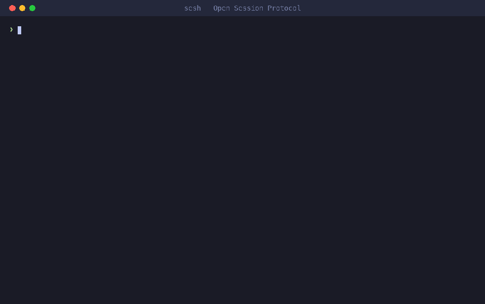

# sesh

**Your coding-agent sessions, in one open format.**

`sesh` reads sessions from **Claude Code**, **OpenAI Codex CLI** and **OpenCode**, converts them into the
**Open Session Protocol (OSP)** - an append-only, branch-aware JSONL format - and lets you inspect, validate and
export them. One static Go binary, no CGO, read-only on your agents' data.



## Why

Every agent CLI stores its history differently, and none of them can read another's. Switch tools mid-task and you
start from zero. OSP is a small, documented format that all of them can be mapped onto, so a session can be
inspected, checked, archived, and (in later phases) moved between agents without losing structure.

What makes OSP different from "dump the chat to JSON":

* **It remembers branches.** `/rewind` doesn't delete anything; the abandoned path stays in the file and a pointer
  event marks which branch is live.
* **Tools are normalised.** Bash, `exec_command`, `bash`... all become `exec`. Seven capabilities cover the lot
  (`exec`, `fs.read`, `fs.write`, `fs.patch`, `search`, `mcp`, `custom`).
* **It survives crashes.** Lines are only ever appended; a half-written last line is detected and ignored.

## Status

| Area | State |
|---|---|
| OSP v0.1 spec + JSON Schema | done - [`spec/SPEC.md`](spec/SPEC.md) |
| Core: reader/writer, active-branch resolver, validator | done |
| Read adapters: Claude Code, Codex CLI, OpenCode | done |
| `list`, `inspect`, `validate`, `convert --to osp` | done |
| Write back into Claude Code / Codex (`convert --to claude\|codex`, `--open`) | planned (Phase 2) |
| Checkpoint engine (LLM + deterministic), `sesh mcp` server | planned (Phase 3) |

`convert` currently exports to OSP only. Nothing here writes into another agent's session store yet.

## Install

```sh
go install github.com/rojinebrahimi/sesh@latest     # or: git clone ... && make build
```

Needs Go 1.22+. The OpenCode adapter uses the pure-Go `modernc.org/sqlite` driver, so there is nothing to compile
against.

## Use

```sh
sesh list                              # newest sessions across all agents
sesh list --agent codex --cwd my-app   # filter

sesh inspect codex:01a00618            # summary + active branch (id prefixes are fine)
sesh inspect claude:4f5b --tail 12 --abandoned 5

sesh validate codex:01a00618           # exit 1 on errors; warnings don't fail
sesh validate --all                    # every session on this machine

sesh convert opencode:ses_36ee -o session.osp.jsonl
sesh validate session.osp.jsonl        # OSP files are valid references everywhere
```

A *ref* is `agent:id-prefix`, a bare id prefix (if unique across agents), or a path to an `.osp.jsonl` file.

Where sesh looks (override with the usual env vars):

| Agent | Location | Override |
|---|---|---|
| Claude Code | `~/.claude/projects/<cwd>/<uuid>.jsonl` | `CLAUDE_CONFIG_DIR` |
| Codex CLI | `~/.codex/sessions/YYYY/MM/DD/rollout-*.jsonl` | `CODEX_HOME` |
| OpenCode | `~/.local/share/opencode/opencode.db` (opened read-only) | `XDG_DATA_HOME` |

An agent you don't have installed is silently skipped.

## What an OSP file looks like

```jsonl
{"osp":"0.1.0","offset":1,"id":"…","parent_id":null,"type":"session.init","workspace":{"root":"/home/me/app"},"origin":{"agent":"codex","model":"gpt-5-codex"}}
{"osp":"0.1.0","offset":2,"id":"…","parent_id":"<init>","type":"turn.item","role":"user","parts":[{"type":"text","text":"fix the failing test"}]}
{"osp":"0.1.0","offset":3,"id":"…","parent_id":"<2>","type":"turn.item","role":"assistant","parts":[{"type":"tool_call","call_id":"c1","capability":"exec","input":{"cmd":"go test ./..."}}]}
{"osp":"0.1.0","offset":4,"id":"…","parent_id":"<3>","type":"turn.item","role":"tool","parts":[{"type":"tool_result","call_id":"c1","status":"error","output":"FAIL"}]}
```

Four event types: `session.init`, `turn.item`, `head.move` (rewind pointer), `session.checkpoint`. Every event has an
`offset` (strictly increasing, so clock skew can't reorder history) and a `parent_id`, which makes the log a DAG. Full
details in the [spec](spec/SPEC.md).

## How the active branch is found (and why you can trust it)

The file stores *everything that ever happened*; an agent needs only the live path. `ResolveActiveBranch`:

1. **HEAD** = the highest-offset `turn.item` or `head.move`. If it is a `head.move`, HEAD is the event it points to.
2. Walk `parent_id` back from HEAD to `session.init`. Pointer events and checkpoints are skipped on the way.
3. Anything not on that path is *abandoned*: kept on disk, not replayed.
4. A missing parent or a cycle is an **error**, never a silently shorter conversation.

Tool calls are paired with results by `call_id` only, so parallel calls finishing out of order are fine.

### Proof, not promise

* **Unit tests** cover rewind, rewind-to-start, redo, move-of-a-move, checkpoints, shuffled on-disk order, missing
  parents, cycles, out-of-order parallel results, duplicate `call_id`s, corrupted tails (and corruption mid-file),
  appending to a crash-damaged file, and a 20,000-turn log with 400 dead-end forks.
* **Mutation-checked adapter fixes.** Each real-world quirk below has a test that fails if the fix is removed.
* **Real data.** `sesh validate --all` (also `make verify`) runs every adapter and the resolver over the sessions on
  your own machine. On the author's machine that is roughly 900 sessions and ~150k active turns; the validator found
  three real bugs in the first draft of the adapters, all fixed and documented:

  | Real-world quirk | Symptom before the fix |
  |---|---|
  | Claude records parallel tool calls as a fork: results hang off their own call, so a plain parent walk drops them | thousands of "unanswered" calls |
  | Claude compaction boundaries point at a parent that is missing - or *later in the file* | each compaction segment became a root; ~half of all history was reported "abandoned" |
  | Codex persists streaming snapshots of one call under the same `call_id` | duplicate `call_id` errors |

  After the fixes: every session validates, ~99.99% of tool calls are paired, and the few left over are runs that
  were interrupted before their result (reported as warnings, not errors).

Run it on yours: `make verify`.

## Project layout

```
spec/                  OSP spec + JSON Schema
internal/osp/          events, JSONL IO, DAG resolver, validator, builder
internal/adapters/     claude/  codex/  opencode/  toolmap/ (vendor tool -> capability)
cmd/                   cobra commands
scripts/demo/          builds the demo GIFs from synthetic fixtures (make demo)
```

## Development

```sh
make test      # go test -race ./...
make verify    # validate every real session on this machine
make demo      # regenerate docs/demo*.gif (pip install pillow)
```

The demo is recorded from the real binary on made-up sessions, never from your data.

## Roadmap

1. **Phase 2** - write adapters so `sesh convert --from codex --to claude` produces a session `claude --resume` loads;
   interactive picker for `list`.
2. **Phase 3** - checkpoint engine (LLM summary when an API key is present, deterministic extraction offline) and
   `sesh mcp`, a stdio MCP server so closed agents can pull a checkpoint plus the last N turns.
3. **Phase 4** - `--open` to launch the target agent, more adapters.

Known gaps: Codex rollbacks and OpenCode reverts are not modelled yet; encrypted reasoning blobs cannot travel between
vendors, so only readable reasoning summaries are kept.

## License

Apache-2.0, see [LICENSE](LICENSE).
